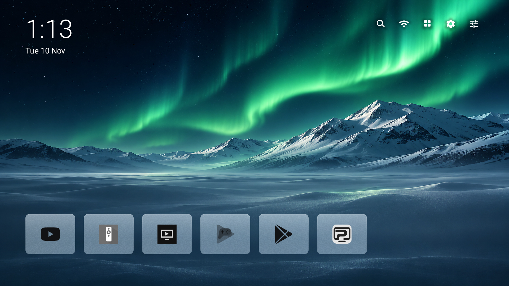
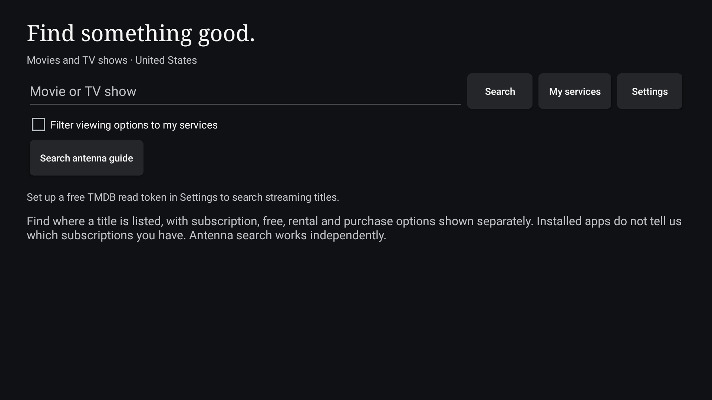

# Plume + Search

Personal fork of [Plume Launcher](https://github.com/aradhyas8/Plume_Launcher), with the title-search feature from [Better TV](https://github.com/PatrickSchaller/BetterTV). The Plume home screen, first-run setup, monochrome app styling, wallpaper options, and controls are retained. Search now shares the current wallpaper and Plume glass surfaces, with a poster grid, artwork-led title details, and grouped provider tiles. A magnifying-glass button joins the top-right controls and uses their existing focus, move, and hide behavior.

Android TV 12 emulator reference screenshots from 1.7.2, before the 1.7.3 search redesign:





Build and test results are recorded in [verification](docs/search-fork-verification.md).

## Install and try

This build is version **1.7.7**, labeled **Plume + Search**, with application ID `dev.patrickschaller.plume`. It installs alongside official Plume and Better TV; each app has separate settings. Install the APK from USB and open **Plume + Search** from the TV's Apps screen.

First try it as a normal app. Before testing its Home-button setup, turn off Better TV's Home button fix and official Plume's Home service so only the selected launcher's service handles Home. The fork keeps Plume's setup process; actual TCL restart behavior still needs checking. No stock launcher is disabled by this change.

The source namespace stays `dev.plume` to keep upstream merges small. If you use ADB, the activity component is `dev.patrickschaller.plume/dev.plume.MainActivity`. The optional Home service is `dev.patrickschaller.plume/dev.plume.HomeOverride`.

## Search setup

1. Select the magnifying glass in the top-right controls.
2. Open **Settings** in Search, then **Import token text file**.
3. Select a UTF-8 text file under 8 KB containing only your TMDB **API Read Access Token**, without quotes or a `Bearer` prefix. Alternatively enter it in the masked field.
4. Remove that token file from the USB afterward. The fork cannot read the token stored in Better TV or official Plume; import it once into this app.
5. Select **My services** to review Installed or Popular providers, or search All services. Save your choices, then switch Viewing options between Everywhere and My services.

Request your personal token through [TMDB API settings](https://www.themoviedb.org/settings/api). Do not commit it or include it in screenshots or issue reports. Search credentials are stored separately from launcher preferences and excluded from Android backup/device-transfer rules and Plume's settings export.

Search uses TMDB movie/show metadata and US watch-provider listings powered by JustWatch. It distinguishes subscription, free, ad-supported, rental, and purchase offers, and can query a TV season. The service filter applies to a selected title's offers. App buttons open the provider's app; they do not promise exact-title playback or confirm a subscription. Availability can change or be incomplete.

**Search antenna guide** reads terrestrial listings already shared by the TV, with permission, over the next 48 hours. It does not download schedules by ZIP, configure the tuner, or schedule recordings. ZIP defaults to 54650 and can be changed. Whether the TCL exposes its guide remains unverified.

## Build and updates

Use the upstream Gradle wrapper with JDK 17 and Android SDK 36:

```powershell
.\gradlew.bat testDebugUnitTest lintDebug assembleRelease
```

APK: `app/build/outputs/apk/release/app-release.apk`. Without a private `keystore.properties`, upstream's build uses the local development signing key. Keep that key privately for subsequent test updates; it is not included in Git. APKs and tool/build caches are also ignored.

The update check points to **PatrickSchaller/Plume_Launcher**, not upstream Plume. Automatic builds and releases of this fork are not configured. Official Plume APKs do not replace this app. Upstream weather, aerial, and wallpaper sources remain unchanged.

The search instrumentation runner is `dev.plume.search.SearchInstrumentation`. It checks parsing/filtering with synthetic fixtures, masked token entry, and the new Home-to-Search navigation. It does not establish successful live TMDB responses without a personal token. Upstream hardware-dependent instrumentation remains in the repository.

## License and credits

The fork retains Plume's GPLv3 license and upstream credits. Search is adapted from PatrickSchaller's Better TV. The TMDB logo and nonendorsement notice and JustWatch credit are included in Search settings. This product uses the TMDB API but is not endorsed or certified by TMDB. Provider artwork and trademarks retain their respective rights.

## Search redesign in 1.7.3

My services starts with installed recognizable apps, or Popular if none match. Installation is a suggestion, never evidence of subscription or login. The picker groups direct plan variants, keeps third-party add-on channels separate, and supports Installed, Popular, Selected, and All services tabs plus name search. Cancel leaves saved choices unchanged; Save retains older selections that are no longer in the catalog unless explicitly removed.

Results are a remote-navigable poster grid. Title details show backdrop art and separate Subscription, Free to watch, and Rent or buy tiles. Free offers may require an account; service buttons open an installed app or the source's availability details. Back restores the previously selected poster. Artwork failure leaves usable labeled placeholders.


## Search and app access in 1.7.5

Title details place artwork beside viewing options. Matching selected services appear first and are named in the fixed header; no initial scroll is needed to find the first option. Search and My Services use TV-safe margins and focus outlines without zooming cards into clipped edges. **All apps → Find apps** opens Google Play, including on devices where its icon is absent from the installed-app grid.

Search accepts simple genre/date phrases, such as **funny movies from the ’90s**, **sci-fi shows from 2020**, **family movies**, or **movies from 1994**. The header shows the interpreted filters. This uses TMDB Discover, not an AI model: arbitrary plot descriptions, actor combinations, conversational follow-ups, and general mood requests are not supported. Unrecognized requests remain ordinary title searches. TV date filters use the series' first-air date, and TV sci-fi/fantasy and action/adventure follow TMDB's combined genre categories.

Clear glass needs a still picture. Plume deliberately uses Frosted for video wallpapers; a plain background has no image to show through glass. The Style settings now explain these conditions even when Clear was not the selected style.

Google TV can use services selected on a Google profile and supported linked streaming accounts ([Google's documentation](https://support.google.com/googletv/answer/10059392)). This fork detects installed apps and uses your explicit selections; it does not read Gmail or infer paid subscriptions. Google Play Billing only returns purchases made within the calling app ([BillingClient](https://developer.android.com/reference/com/android/billingclient/api/BillingClient)).

Version 1.7.5 passes 146 unit tests and 79 Android TV UI checks in each of light and dark mode. See [verified UI results and screenshots](docs/search-ui-1.7.5.md). Live TMDB data and physical TCL behavior remain separate hardware checks.

## Readability and recent activity in 1.7.6

Top controls have permanent light/dark backplates over wallpaper. App tiles keep stronger neutral glass tint and full-brightness monochrome marks; menus use a stronger wash, with the Wallpaper theme's colors bounded for text contrast. Wallpaper and glass texture remain visible behind these surfaces.

This update enables **Recently used** ordering once. Apps opened through Plume, its show cards, or its search provider buttons move toward the left when you return Home. Existing saved manual order is retained, and **Plume settings → Apps row → Order** offers Recently used, Manual, and Most used. No Android Usage Access permission is requested; app launches outside Plume, such as a service-specific remote shortcut, are not tracked.

Continue Watching now places recent resumes ahead of older items across services. A title opened through a show card is marked **Last opened**, and its local resume time helps order it while the service updates Watch Next. This means an opened title, not proof playback began. Opening an app alone no longer makes every title in its channel look newly watched. The launcher can only show titles supplied by enabled Watch Next/providers; it cannot recover a service's private viewing history or invent missing progress. See [Android's Watch Next guide](https://developer.android.com/training/tv/discovery/watch-next-add-programs).

Version 1.7.6 passes 148 unit tests and 107 emulator checks per theme. See [home verification and screenshots](docs/home-ui-1.7.6.md).

## Faster query entry in 1.7.7

Search opens with its query focused and, once TMDB setup is complete, requests the TV keyboard. **Up** from any card in the first poster row goes directly to **New search**. OK clears the previous query, focuses input and opens the keyboard. This explicit action avoids TV keyboards inconsistently replacing selected text. The field also uses Android's select-all-on-focus behavior for editing; **Down** from the query returns to the first poster when the keyboard is closed. No-match results return to query entry automatically. This APK also includes the 1.7.6 home readability and recency changes.

Version 1.7.7 passes 148 unit tests and 119 emulator checks per theme. See [query input verification](docs/query-input-1.7.7.md).
