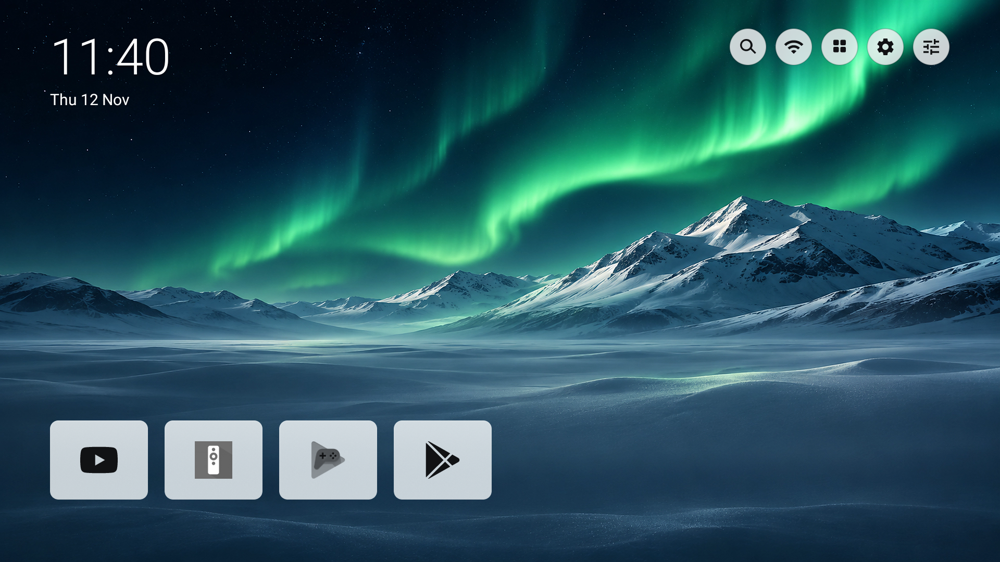
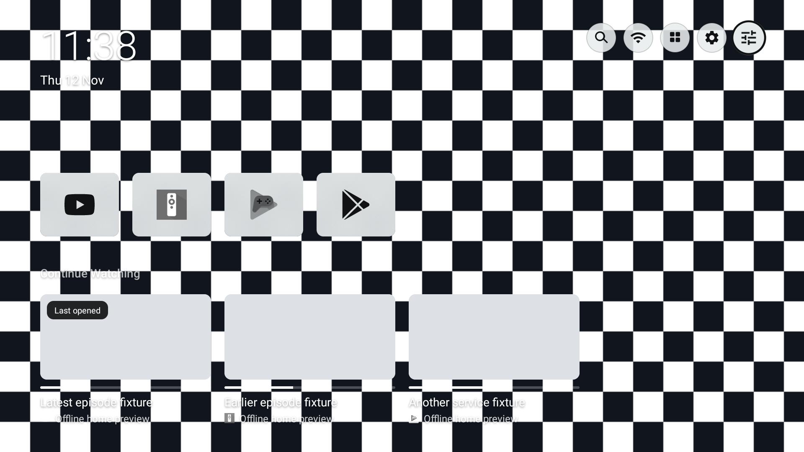
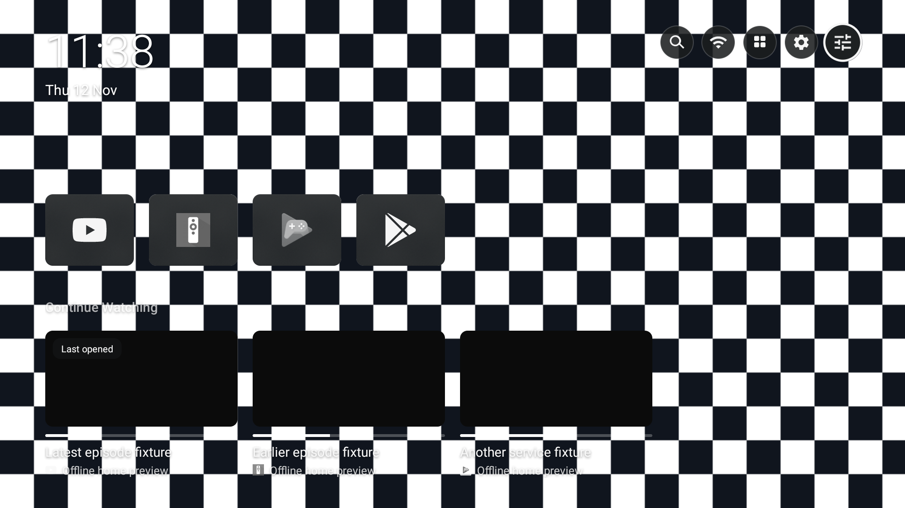

# Home readability and recency: 1.7.6

Verified November 12, 2026 with the repaired Android TV 12/API 31 emulator at 1920×1080, density 320. Package `dev.patrickschaller.plume`, version code 15.

## Behavior

- Home controls have permanent light/dark circular backplates over wallpaper, with a stronger focus outline. The disconnected network icon is dimmed less aggressively.
- App tiles use a stronger neutral tint and full-brightness marks. Frosted and Clear textures remain; menus use a stronger wash. Wallpaper-theme panel colors are bounded so saturated artwork cannot make the panel too bright in dark mode or too dark in light mode.
- The first start after this update enables **Recently used**. It sorts apps by their last successful launch through Plume, show cards, or search provider buttons. The saved manual ordering is retained. **Plume settings → Apps row → Order** offers Recently used, Manual, and Most used; choosing Manual or moving a tile switches back to manual order.
- Continue Watching prioritizes recent resumes across services rather than reserving early slots for older titles from each service. The latest show card opened through Plume has a **Last opened** badge. Its local open time supplements the provider's engagement time while the provider updates its row.
- A provider channel without playback timestamps keeps its supplied order. Opening that provider's app no longer promotes every title in its channel as though each was watched.

## Verification

- 148 unit tests pass with zero failures. Coverage includes the new recent-resume key, portable Recently used settings, and surface contrast across bright/dark/saturated backgrounds for both glass styles and light/dark/Wallpaper themes. Tested surface/text pairs meet 4.5:1 in those fixtures; this is not a certification of all app artwork or text on the home screen.
- 107 emulator checks pass in light mode and again in dark mode. New checks exercise actual recent/frequency/manual app ordering, successful dispatch recording, failed launch exclusion, badge visibility, permanent control backplates and rendered opacity for Frosted and Clear.
- Existing search, My Services, app-store launch, token masking and Back-navigation checks continue to pass.
- Debug/release builds and lint pass against the upstream baseline. Lint reports 119 visible warnings; 10 existing errors and 23 warnings are filtered by the existing baseline.
- The optimized release installs over the earlier fork, opens Home, and exposes all three Order choices in **Apps row**. Its crash buffer stays empty through the final smoke test.

Optimized release Home with the normal built-in Aurora wallpaper:

The first new failure came from a test monitor that also intercepted the intentionally invalid launch. The fixture now uses a different intent category so the missing app really fails. Screenshot review also removed a redundant blur patch from unfocused top controls. These failures are not claimed as passing checks.

## Layout stress fixtures

These actual screenshots use a deliberately extreme checkerboard and offline show placeholders from the test APK. The checkerboard, preview shows and history do not ship in the app. This fixture isolates control/app-mark readability; existing adaptive text over wallpaper is not a full accessibility audit.

| Glass | Light | Dark |
|---|---|---|
| Frosted |  |  |
| Clear |  |  |

## Limits

Release APK: `Plume-Search-1.7.6.apk`, 518,083 bytes. SHA-256: `4c067ff27def869991f3ecda64cb86006d47de12af36695884a3ddb639f78c0c`. APK v2 signature verification passes and the retained signing identity supports an in-place update over earlier fork builds.

App recency covers launches through Plume. No Android Usage Access permission is requested, so service-specific remote buttons and launches through other apps are outside this history. Show ordering depends on enabled providers' Watch Next/channel data and local show-card opens. **Last opened** indicates dispatch to a title, not proof that playback began. No missing title, private service history, or playback progress is fabricated. See [Android's Watch Next documentation](https://developer.android.com/training/tv/discovery/watch-next-add-programs).

The physical TCL's picture settings, scaling and streaming-provider behavior remain unverified. No TV firmware or Google launcher package was modified.
