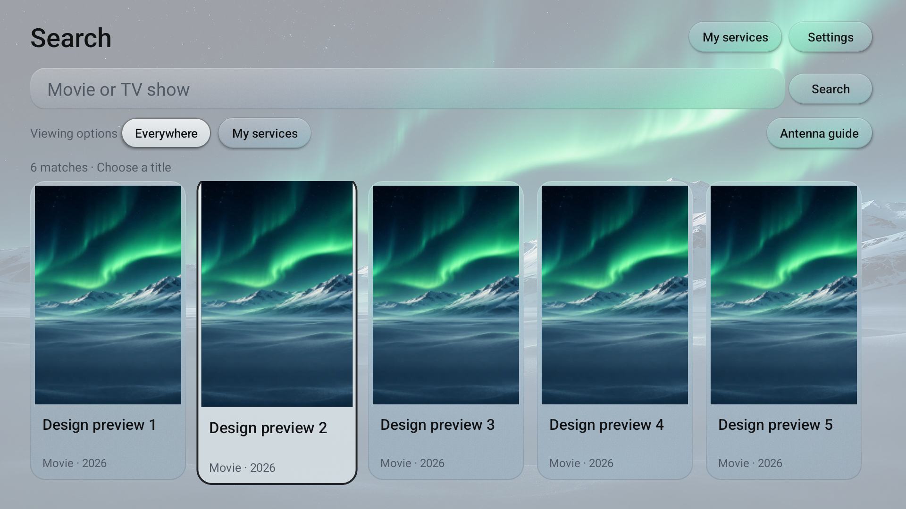
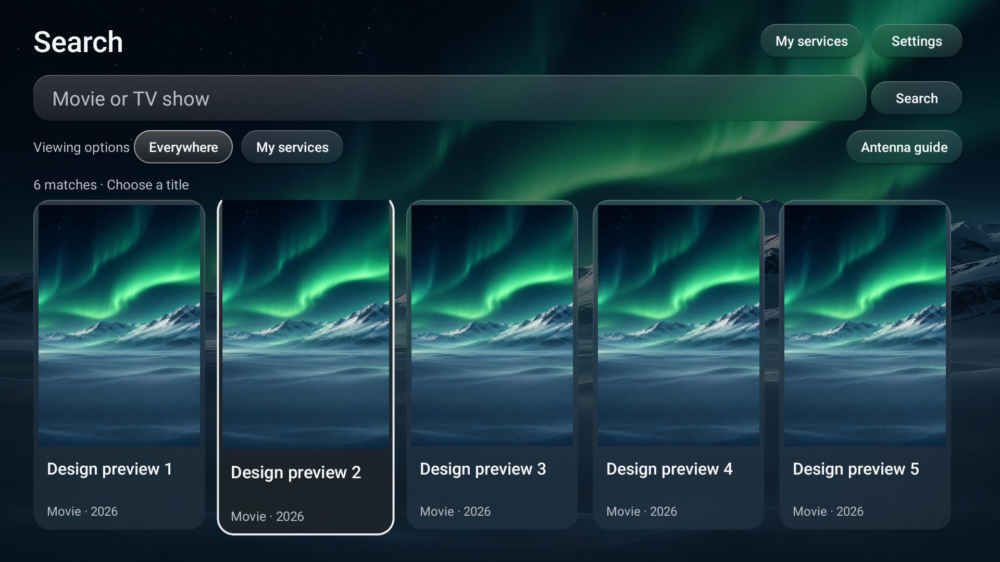
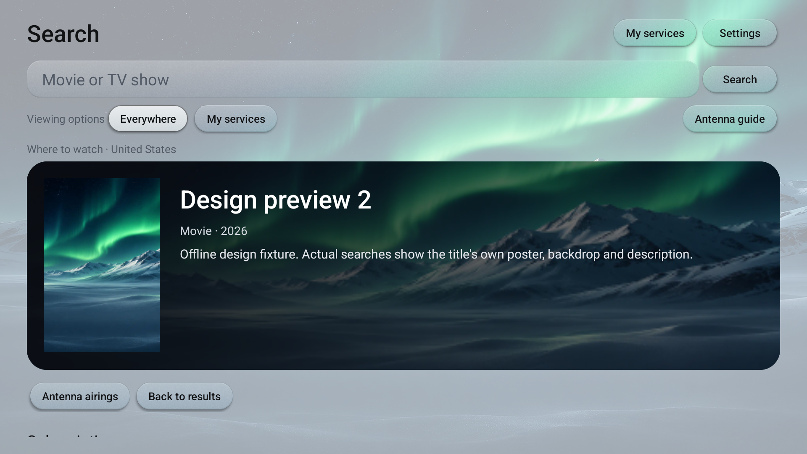
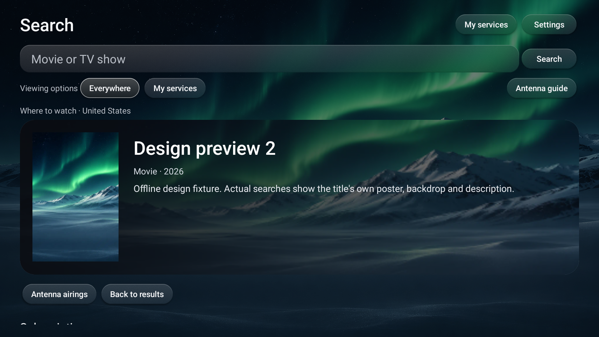
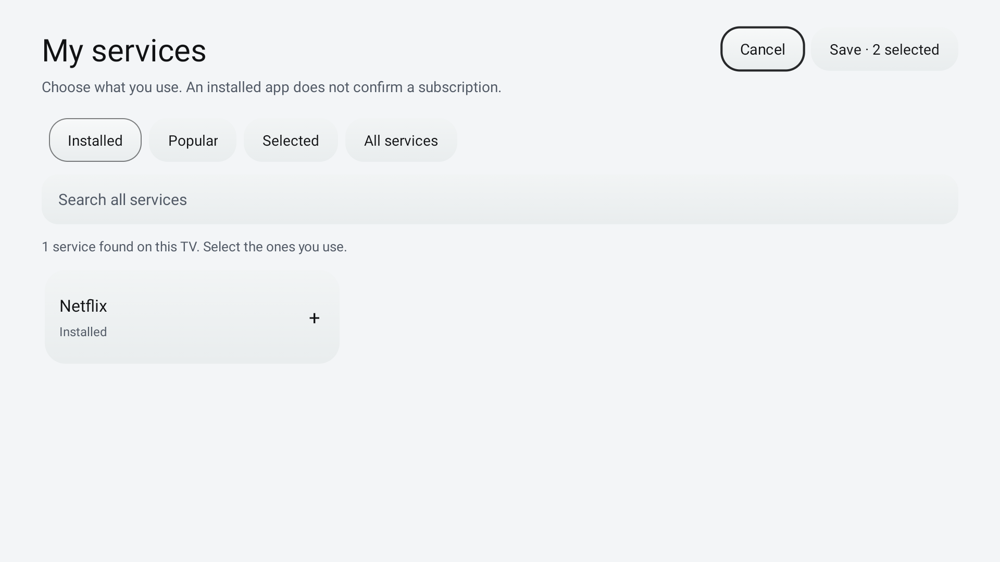
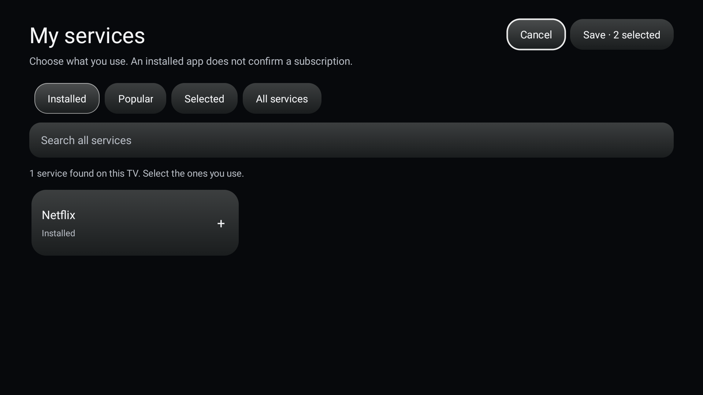
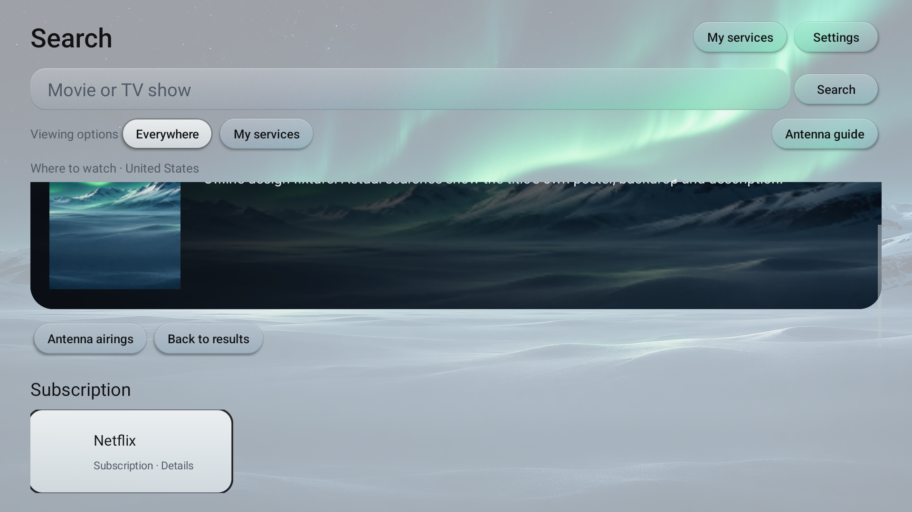
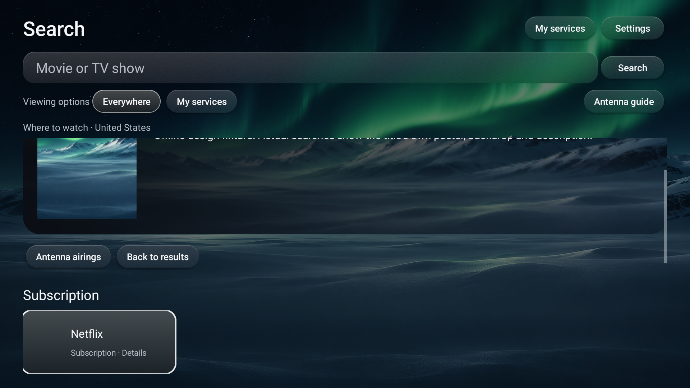

# Search UI verification: 1.7.4

Verified November 10, 2026 on the Android TV 12 (API 31) emulator, 1920x1080 at TV density. Package `dev.patrickschaller.plume`, version code 13. The emulator authorization repair is documented in [emulator testing](emulator-testing.md); original AVD userdata was preserved.

## Results

- 144 unit tests pass, with no failures.
- 70 Android search/picker/navigation checks pass in **light** mode and again in **dark** mode (`INSTRUMENTATION_CODE: -1` in both runs).
- My Services: installed suggestions do not auto-select subscriptions; plan variants are grouped; add-on search is distinguished; toggling preserves focus; Cancel preserves saved selections; Save retains existing and unavailable IDs while adding explicitly chosen services.
- Search: poster D-pad navigation, selected-title Back to results with restored poster focus, and Back to the same Plume Home all pass. Subscription, free, and rental tiles can be reached sequentially using Down.
- Token masking, artwork-path validation, source-link validation, terrestrial guide filtering, and preference preservation pass. Shared styling keeps decorative backgrounds out of focus traversal and does not continuously invalidate an idle panel.
- Debug/release builds and lint pass with the existing upstream baseline. Lint reports 0 new errors and 121 visible warnings; 10 existing errors and 23 existing warnings remain filtered by that baseline.
- The optimized release APK was installed after debug testing and opened through its real Search button. Crash buffer stayed empty during the final test runs and release smoke test.

Visual inspection found that the previous header left too little space for poster titles. Version 1.7.4 reduces the header/button height so the first poster row's titles and metadata fit at normal TV text size. The test drawable's missing bounds and asynchronous return-window check were also corrected; these were test setup/timing issues.

## Screenshots

These are actual emulator screenshots populated with **offline design fixtures** in the test APK. The repeated scenic images and preview title names are deliberate fixtures, not live TMDB results or verified streaming offers. Fixture data does not ship in the app.

| Screen | Light | Dark |
|---|---|---|
| Poster results |  |  |
| Title detail |  |  |
| My Services |  |  |
| Focused provider |  |  |

## Test APK

- Filename: `Plume-Search-1.7.4.apk`.
- Optimized APK size: 514,519 bytes.
- SHA-256: `73e501eb31ec4f691983b5bcec1c164ff049a65858817bb81a0bf0d7321a466f`.
- APK signature verification passes; the local development signing identity is retained. Installing over the earlier fork preserves its private preferences and token.

Live TMDB catalog/provider/artwork requests with a real token, service login/entitlement, and physical TCL performance/Home restart behavior remain unverified. These tests establish the offline UI and selection flows, not streaming access or hardware compatibility.
