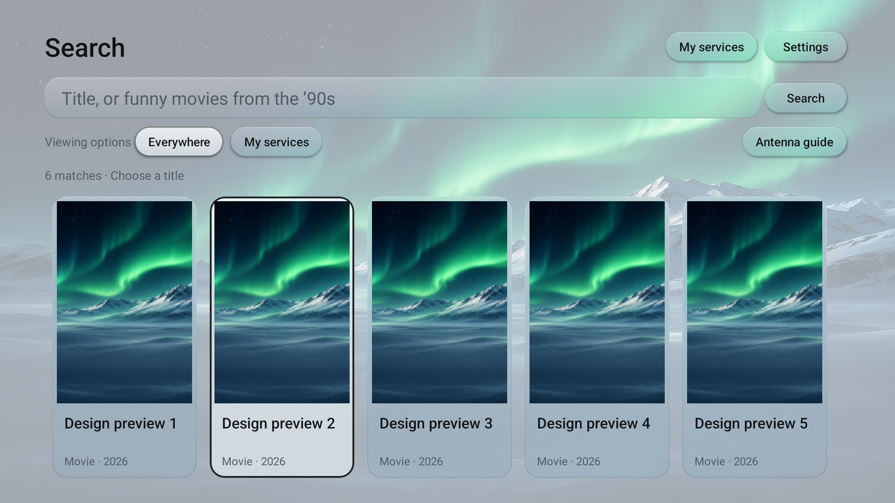
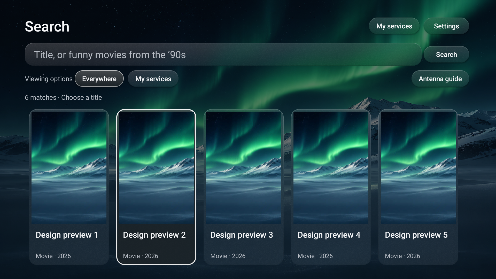
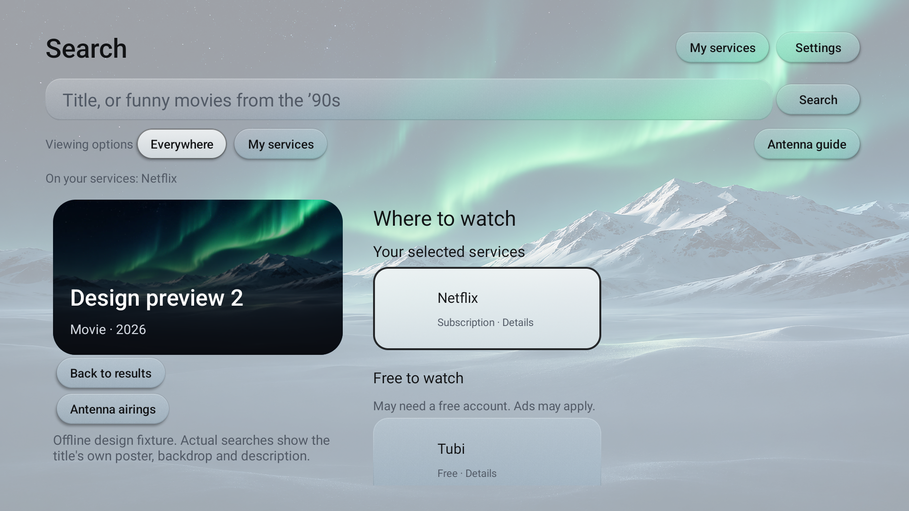
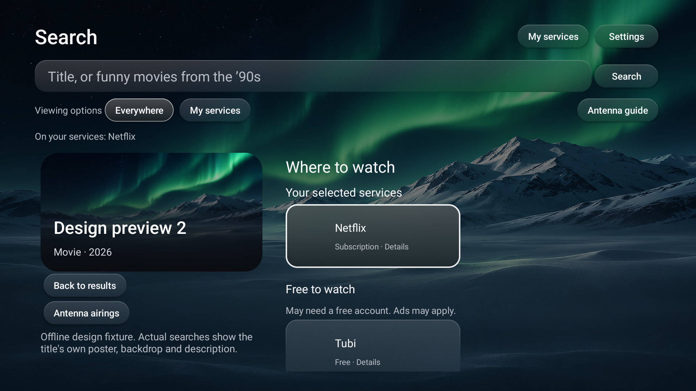
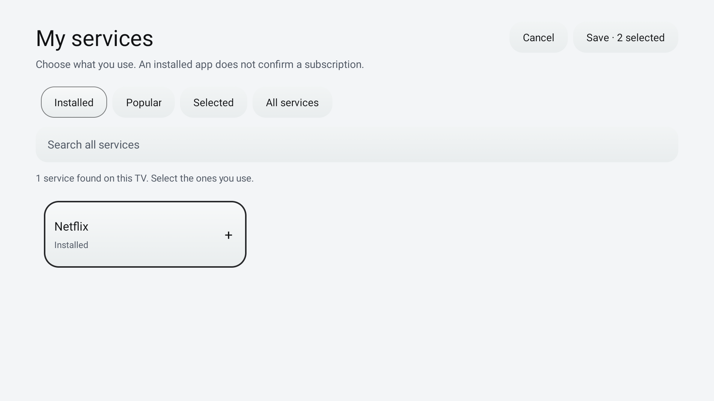
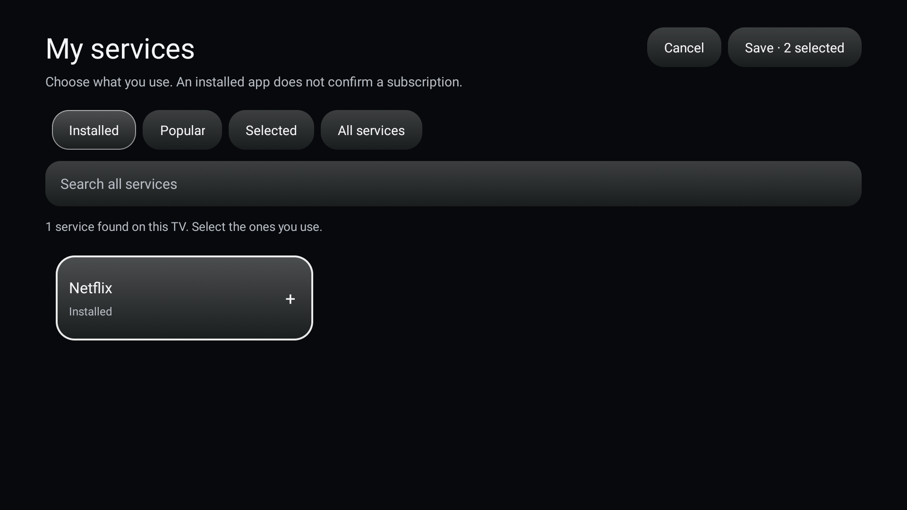
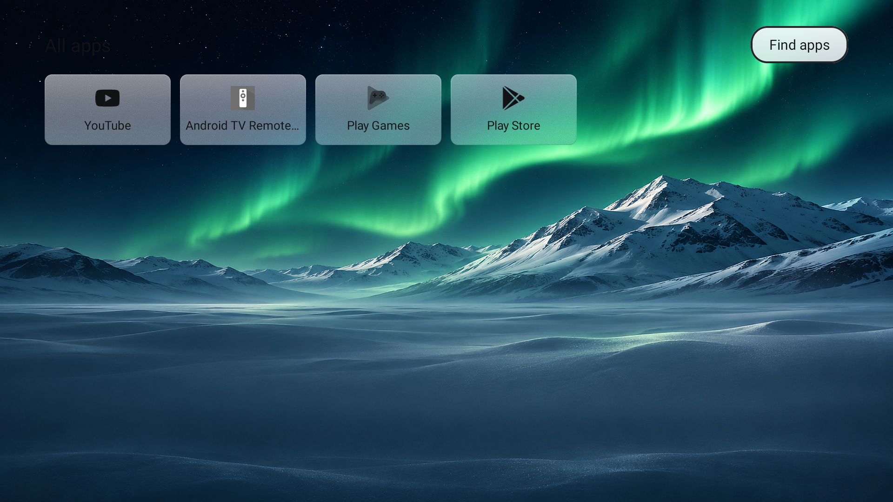
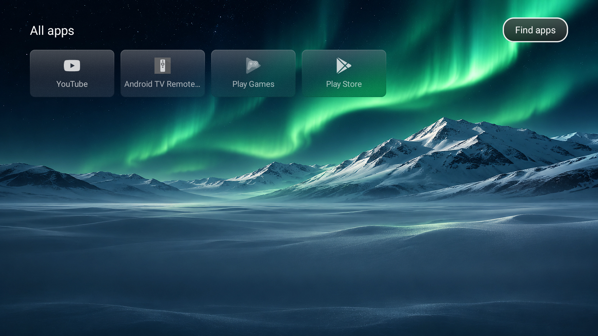

# Search UI verification: 1.7.5

Verified November 11, 2026 on the Android TV 12 (API 31) emulator, 1920×1080 at density 320. Package `dev.patrickschaller.plume`, version code 14. The existing repaired emulator profile remained authorized.

## Changes and checks

- 146 unit tests pass, with zero failures/errors. New tests check genre synonyms, straight/curly apostrophes, movie versus TV genre/date filters, valid years/decades, and preservation of ordinary title searches.
- 79 Android UI/parser/navigation checks pass in light mode and again in dark mode (`INSTRUMENTATION_CODE: -1`).
- Poster and service focus stay inside the safe area. The first provider and matching-service header are fully visible without an initial scroll. Filtering removes unselected providers and the no-match state remains visible.
- D-pad navigation between subscription, free, and rental options, Back to the selected poster, Back to Plume, and My Services Save/Cancel pass.
- The app drawer exposes a focusable **Find apps** control. An instrumentation activity monitor verifies the TV Play Store launch intent. The optimized release was then tested without the monitor and opened the actual Play Store sign-in screen (`com.android.vending`); no account was entered or app installed.
- The real Android JSON parser accepts Discover responses that omit `media_type`, using the requested movie/TV endpoint's kind.
- Debug/release builds and lint pass against the existing upstream baseline. Lint reports 119 visible warnings; 10 existing errors and 23 warnings remain filtered by the baseline.
- The crash buffer remained empty through instrumentation and the optimized release smoke test.

Screenshot inspection caught a clipped border even after the original unscaled-bounds assertion passed. Removing search/picker zoom fixes it; the visibility assertion now also accounts for transformed bounds. A visible outline and lit surface continue to indicate focus. Plume's home-row animation is unchanged.

## Screenshots

These are actual emulator screenshots using **offline test fixtures**. The scenic art, preview titles and service availability are test data, not live TMDB listings. Fixtures are compiled only into the test APK.

| Screen | Light | Dark |
|---|---|---|
| Poster results |  |  |
| Title and services |  |  |
| My Services |  |  |
| Find apps |  |  |

## Release artifact

Release APK: `Plume-Search-1.7.5.apk`, 518,347 bytes. SHA-256: `f4d25c612f96f1b63d7ded6d013bc001c69c9f5e33b6aec3f85622ce66520dd2`. APK v2 signature verification passes, and the optimized APK installs over the previous fork using the retained signing identity. Its real Search control opens the new search screen with genre/date examples.

## Limits

Genre/date phrases use documented [TMDB movie Discover](https://developer.themoviedb.org/reference/discover-movie) and [TV Discover](https://developer.themoviedb.org/reference/discover-tv) filters. This is a small explicit vocabulary, not general conversational search. Unsupported phrases are searched as titles. TV dates refer to series premieres. The service toggle filters a selected title's viewing options, not the entire result catalog.

No Google account or Gmail access was added. Installed apps and selected services do not verify subscriptions or exact plan access. Video wallpapers retain upstream's Frosted fallback; Clear is available with still images.

Live TMDB requests with a real token, actual TCL display scaling/performance, signed-in Play Store installation, streaming access, and Home-service restart behavior remain unverified.
